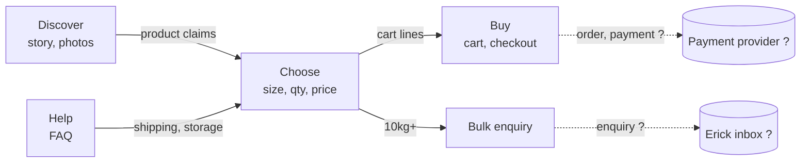

# Landscape: rawrooibos.com

Skills used: 03-ux-design/platform-map, 03-ux-design/feature-placement. Sources: the repo (`app/`, `components/`, `lib/`), the live page read on 2026-10-24, PRODUCT.md. Today's state first; the redesign is placed after.

## Platform

### Zones
| Zone | Purpose | Main objects | Owner |
|---|---|---|---|
| Discover | Say what it is and why it is different | Story, photos, product facts | Erick (content) |
| Choose | Pick size and quantity | Product, pack size, price | Erick |
| Buy | Cart, then checkout | Cart, order (planned) | Erick; payment provider not yet chosen (?) |
| Bulk | 10kg+ enquiry for cafés and shops | Bulk enquiry | Erick |
| Help | Answer doubts before ordering | FAQ, shipping and storage facts | Erick |

### Streams
- Discover → Choose: product claims (unpasteurised, caffeine-free), live on page.
- Choose → Buy: pack size, quantity, subtotal (client state, `lib/cart-context.tsx`).
- Buy → outside: order and payment (planned, `app/checkout`; provider unknown).
- Choose → Bulk: the "Ordering 10kg or more?" callout links to an enquiry form (`ContactSheet`); where submissions go is unknown.
- Help → Choose: shipping limits (South Africa, 2 to 4 working days) currently live only in the FAQ.

### Sources of truth
- Product, sizes, prices: `lib/products.ts`.
- Visual rules: `DESIGN.md`, `design-tokens.json`.
- Product facts and copy: the components; no CMS.

### Unknowns and who can answer
- Payment provider and checkout steps: Erick.
- Where bulk enquiries are delivered: Erick.
- Shipping cost rules ("calculated at checkout"): Erick.

## Placement

The redesign is a standalone HTML file that touches every zone's surface but no data or backend.

| Object | Read / create / change |
|---|---|
| Product, pack sizes, prices | Read (copied from `lib/products.ts`) |
| Cart | Simulated in the file |
| Bulk enquiry | Simulated (no submission) |
| Copy, CTA labels | Change |
| Visual tokens | Read, possibly change (G0 Q1) |

### Ripple test
| Change | 1st order | 2nd order | 3rd order | Severity | Owner, response |
|---|---|---|---|---|---|
| New CTA labels | Page wording changes | Must match checkout and email wording when ported to the app | Support answers, SEO snippet | Medium | Erick: carry the label set into the app as one list |
| New visual tokens | File looks different from live site | DESIGN.md and tokens drift from the file | Next build must choose one | Medium | Erick decides at G4; record in decisions.md |
| Shipping info moved next to buy box | Clearer cost expectations | Must stay true to real shipping rules | Complaint risk if wrong | High | Erick confirms the facts (A6) |
| Bulk becomes a first-class path | More enquiries possibly | Someone must answer them | Pricing for 10kg+ needed | Medium | Erick (G0 Q5) |
| Photos embedded in the file | Portable, one file | File size near 5 to 6 MB | Slow on mobile data | Medium | Erick (G0 Q3); compress if embedded |

### Brief impacts
- The file is a design deliverable; porting to the Next.js app is a follow-up.
- Research must check: how small-batch food shops label buy CTAs; domain wording for "unpasteurised".
